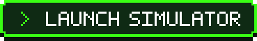
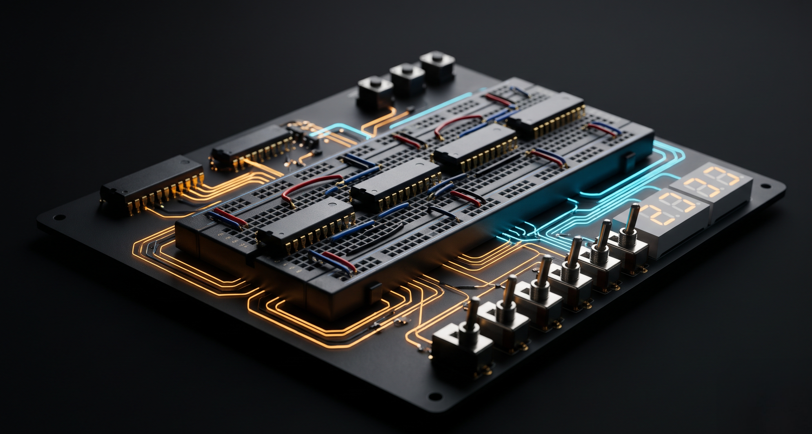
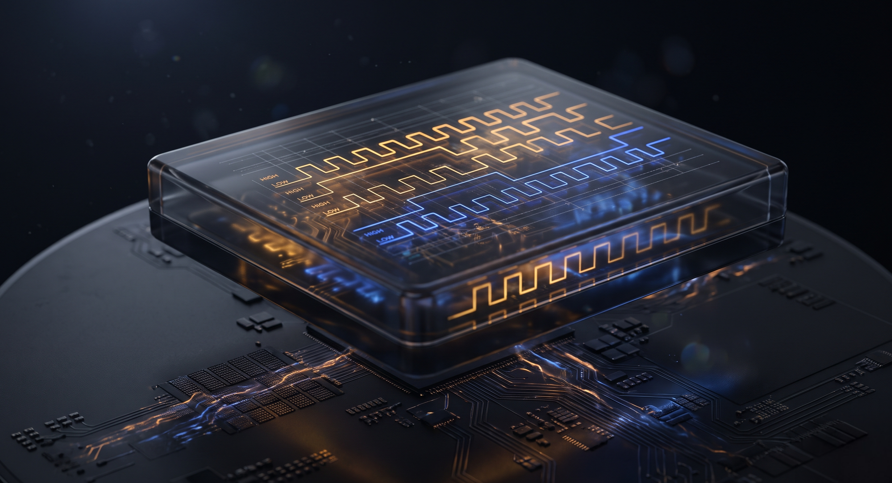
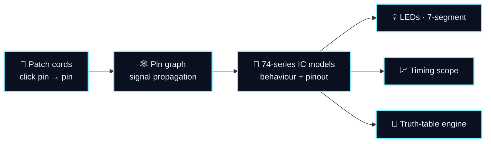

<div align="center">



<br>

<a href="https://srijans123.github.io/Digital-Design-Trainer-Kit-Simulator/"></a>&nbsp;
<a href="#quick-start"></a>&nbsp;
<a href="#level-select"></a>

<br><br>


<br><br>

**Wire it. Probe it. Break it. Repeat. Zero burnt ICs.**

<br>

<table>
<tr>
<td align="center" width="140"><br><b>19</b><br><sub>74-series ICs</sub></td>
<td align="center" width="140"><br><b>8</b><br><sub>lab experiments</sub></td>
<td align="center" width="140"><br><b>2<sup>N</sup></b><br><sub>auto truth tables</sub></td>
<td align="center" width="140"><br><b>0</b><br><sub>dependencies</sub></td>
<td align="center" width="140"><br><b>0</b><br><sub>burnt ICs</sub></td>
</tr>
</table>


</div>

<a id="what-is-this"></a>
##  What is this?

Real digital labs come with real problems: loose patch cords, a 7474 that gave its life for your grade, and a breadboard that worked *five minutes ago*.

This repo is a **browser-based, pin-accurate simulator of the Physitech PHY-1002 Universal Digital Lab Trainer Kit**, built for the **BITS Pilani, Hyderabad Campus** Digital Design course (`CS F215 / ECE F215 / EEE F215 / INSTR F215`). Rehearse every experiment from the [course handout](https://www.scribd.com/document/1054436513/Cs-f215-Digital-Design-Handout) before you ever touch hardware.

<table>
<tr>
<td width="64" align="center"></td>
<td><b>Zero-dependency, native architecture.</b> Pure HTML5, CSS3, Vanilla JS and WebGL. No bundler, no npm, no remote compilation.</td>
</tr>
<tr>
<td align="center"></td>
<td><b>Physical kit accuracy.</b> The dual-board layout, breadboard turret sockets, toggle input switches, LED monitors and 7-segment decoders of the real PHY-1002.</td>
</tr>
</table>


<a id="eye-candy"></a>
##  Eye Candy

<!-- TODO: drop a real screenshot of the simulator here, e.g. Assets/simulator-screenshot.png -->
<table>
<tr>
<td width="50%"></td>
<td width="50%"></td>
</tr>
<tr>
<td align="center"><sub>Trainer kit PCB, macro</sub></td>
<td align="center"><sub>Logic waveform, 3D</sub></td>
</tr>
</table>

<p align="center">
<a href="Assets/demo-wiring-loop.mp4"><b>▶ Wiring demo</b></a> &nbsp;·&nbsp; <a href="Assets/demo-waveform-7seg-loop.mp4"><b>▶ Waveform + 7-segment demo</b></a>
</p>

<!--
Tip: to autoplay a video inline, drag the .mp4 into the GitHub README editor.
GitHub uploads it and gives you a URL; paste that URL on its own line right here.
-->

<a id="features"></a>
##  Features

<table>
<tr>
<td width="50%" valign="top">
<br>
<b>Patch-cord wiring &amp; turret pin graph</b><br>
Click-to-connect jumper engine with automatic pin-to-pin signal propagation. Pick a wire colour, remove wires on the fly, and watch the live <b>Wire Connection Diagram</b> list every jumper with its pins and its <code>HIGH</code> / <code>LOW</code> state.
</td>
<td width="50%" valign="top">
<br>
<b>74-series TTL logic library</b><br>
Behavioural and pinout models for standard 14-pin and 16-pin DIP ICs: gates, adders, an ALU, MUXes, decoders, flip-flops, shift registers and counters. <a href="#ic-library">See the full roster.</a>
</td>
</tr>
<tr>
<td valign="top">
<br>
<b>Preloaded F215 experiments</b><br>
One click loads the complete wiring map for each standard lab experiment. <a href="#level-select">Pick a level.</a>
</td>
<td valign="top">
<br>
<b>Real instrumentation</b><br>
Office-style ribbon tabs, an automatic truth-table generator, a multi-channel timing scope and a one-click printable lab record. <a href="#instrument-panel">See the panel.</a>
</td>
</tr>
</table>

<a id="ic-library"></a>
##  IC Library

|  | Category | ICs on the bench |
|:-:|:--|:--|
|  | **Basic &amp; universal gates** | `7400` NAND · `7402` NOR · `7404` NOT · `7408` AND · `7432` OR · `7486` XOR |
|  | **Arithmetic &amp; comparison** | `7483` 4-bit full adder · `7485` 4-bit magnitude comparator · `74181` 4-bit ALU |
|  | **Multiplexers &amp; decoders** | `74138` 3-to-8 decoder · `74151` 8-to-1 MUX · `74153` dual 4-to-1 MUX · `7447` BCD to 7-segment decoder |
|  | **Flip-flops &amp; registers** | `7474` dual D flip-flop · `7476` dual J-K flip-flop · `74194` 4-bit bidirectional universal shift register |
|  | **Counters** | `7490` decade counter · `7493` 4-bit binary counter · `74163` synchronous 4-bit binary counter |

<a id="level-select"></a>
##  Level Select

Eight missions from the F215 lab manual, each preloaded with its full wiring map.

|  | Level | Mission | Chips |
|:-:|:-:|:--|:--|
|  | **01** | Basic &amp; universal logic gates verification | `7400` `7402` `7404` `7408` `7432` `7486` |
|  | **02** | Half adder &amp; full adder from basic gates | basic gates |
|  | **03** | 2's complement 4-bit adder/subtractor with overflow detection | `7483` |
|  | **04** | 4:1 multiplexer function implementation &amp; expansion | `74153` |
|  | **05** | BCD to 7-segment display decoding | `7447` |
|  | **06** | J-K flip-flop truth table &amp; toggle-mode verification | `7476` |
|  | **07** | 4-bit asynchronous ripple counter | `7493` |
|  | **08** | 4-bit magnitude comparator | `7485` |

<a id="instrument-panel"></a>
##  Instrument Panel

The ribbon is organised like an office suite, so you never hunt for a tool:

<table>
<tr>
<td align="center" width="20%"><br><b>Wiring &amp; Power</b></td>
<td align="center" width="20%"><br><b>Lab Experiments</b></td>
<td align="center" width="20%"><br><b>Analysis &amp; Truth Table</b></td>
<td align="center" width="20%"><br><b>IC Library &amp; Photos</b></td>
<td align="center" width="20%"><br><b>Print &amp; Export</b></td>
</tr>
</table>

-  **Automated truth-table generator.** Cycles through all 2<sup>N</sup> input-switch combinations, evaluates the logic graph and highlights the output states.
-  **Timing scope canvas.** Live, multi-channel digital waveform visualisation.
-  **Print &amp; screenshot mode.** One-click printable lab record with circuit telemetry.
-  /  **Signal states.** Every net reads `HIGH` or `LOW`, on the wire diagram and on the LEDs.

<a id="how-it-works"></a>
##  How it works (high level)



### Simulation Methodology & Engine Architecture

1. **Topological Pin Graph Network**
   Every breadboard turret socket and IC pin on the dual-board Physitech PHY-1002 represents an addressable graph node. Jumper wires create bidirectional net edges. Connecting an input socket to an output or power rail binds them into a unified electrical net.

2. **Discrete TTL IC Behavioral Engine**
   ICs are not static lookup tables; each chip evaluates discrete Boolean gate transfer functions matching Texas Instruments / standard TTL specifications:
   - **Gate Arrays** (`7400`, `7402`, `7404`, `7408`, `7432`, `7486`): Continuous bitwise gate evaluation.
   - **Combinational MSI** (`7483`, `7485`, `74138`, `74151`, `74153`, `74181`, `7447`): Multi-bit arithmetic, binary comparison, decoding, and segment driver logic.
   - **Sequential Logic** (`7474`, `7476`, `74194`, `7490`, `7493`, `74163`): Edge-triggered clock transitions, internal state registers, asynchronous preset/clear overrides, and count sequencing.

3. **Multi-Pass Signal Propagation & Stabilization**
   When any toggle switch, clock pulse, or patch wire changes state, the propagation loop sweeps active nets in topological order until all feedback paths and output nodes stabilize, preventing race conditions.

4. **Automated $2^N$ Truth-Table Verification**
   The truth-table engine isolates identified input switches, iterates systematically through all $2^N$ binary input permutations, propagates logic states through the current circuit wiring, and captures output LED states to construct a complete verification matrix.

5. **Multi-Channel Oscilloscope Sampling**
   A dedicated Canvas timing scope continuously captures binary transitions on probe channels at fixed clock intervals, displaying synchronized digital waveforms (such as divide-by-2 square waves for flip-flops).

<a id="quick-start"></a>
##  Quick Start

No build tools. No package manager. Just a browser (Chrome, Edge, Firefox or Safari).

```bash
# 1. grab it
git clone https://github.com/srijans123/Digital-Design-Trainer-Kit-Simulator.git
cd Digital-Design-Trainer-Kit-Simulator

# 2. open it
#    index.html                                -> landing page with the WebGL wave shader
#    physitech_phy_1002_simulator_fixed.html   -> straight into the simulator
```

Prefer a local server? Any static one works:

```bash
python -m http.server 8000   # Python
npx serve .                  # Node
```

Then visit `http://localhost:8000`.

<a id="project-map"></a>
##  Project Map

```
Digital-Design-Trainer-Kit-Simulator/
├── .github/workflows/                       # GitHub Actions
├── Assets/
│   ├── pixel/                               # pixel-art icons + animated banner used in this README
│   ├── demo-waveform-7seg-loop.mp4
│   ├── demo-wiring-loop.mp4
│   ├── hero-liquid-orb-loop.mp4
│   ├── hero-liquid-core.jpg
│   ├── logic-waveform-3d.jpg
│   └── trainer-kit-pcb-macro.jpg
├── public/assets/
├── index.html                               # landing page with WebGL 3D wave shader
├── physitech_phy_1002_simulator_fixed.html  # the full PHY-1002 trainer kit simulator
├── .gitignore
└── README.md
```

<a id="faq"></a>
##  FAQ

<details>
<summary><b>Will this burn my ICs?</b></summary>
<br>
No. Nothing in here can burn, so patch fearlessly.
</details>

<details>
<summary><b>Do I need Node, npm or a bundler?</b></summary>
<br>
No. It is plain HTML, CSS and JavaScript. Open the file and go.
</details>

<details>
<summary><b>Is it accurate to the real kit?</b></summary>
<br>
It is a pin-accurate simulation of the PHY-1002 layout and the 74-series ICs listed above. Use it to rehearse, then confirm on the real hardware in the lab.
</details>

<details>
<summary><b>Which course is this for?</b></summary>
<br>
BITS Pilani, Hyderabad Campus: <code>CS F215</code>, <code>ECE F215</code>, <code>EEE F215</code> and <code>INSTR F215</code> Digital Design. The experiments follow the <a href="https://www.scribd.com/document/1054436513/Cs-f215-Digital-Design-Handout">course handout</a>.
</details>

<a id="contributing"></a>
##  Contributing

Found a wiring bug? Want another 74xx chip on the bench? [Open an issue](https://github.com/srijans123/Digital-Design-Trainer-Kit-Simulator/issues) or send a pull request.

<a id="license"></a>
##  License

MIT License. Designed for academic and educational use for the BITS Pilani Digital Design curriculum.

<div align="center">


<br>

<a href="https://github.com/srijans123/Digital-Design-Trainer-Kit-Simulator"></a>

**If this saved you a burnt IC, star the repo.**

<br>

 &nbsp;Built for the BITS Pilani Digital Design lab

<sub>Unofficial project. Physitech and BITS Pilani names are used only to describe compatibility with the course lab.</sub>

</div>
